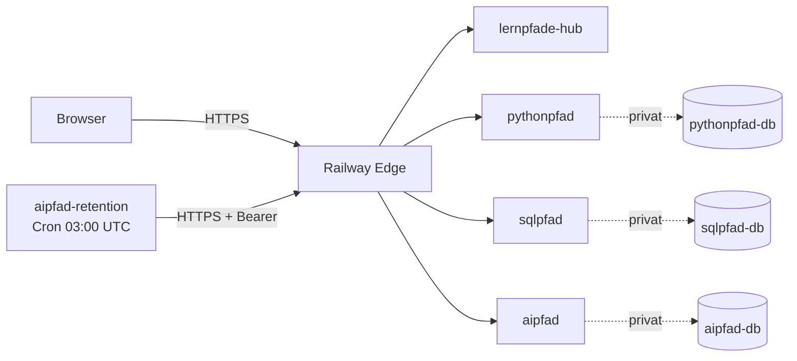

# Umzug von PythonPfad, SQLPfad und AIPfad auf Railway

**Status: Phase 1 bis 3 ausgeführt am 18.11.2026** (Abschnitt 11). Die drei
Apps laufen auf Railway-Staging, und der Hub verlinkt sie. Offen sind:

- die gemeinsame Domain (E1) und damit die Föderation;
- der Rundgang mit Testkonto (B7);
- der Löschmodus des Aufbewahrungslaufs.

Der Plan selbst entstand auf Commit `ee1c775`. Die Abschnitte 1 bis 10 stehen
unverändert so, wie sie freigegeben wurden.

## 1. Ziel und Grenzen

**Ziel**

- PythonPfad, SQLPfad und AIPfad laufen wie der Hub im Railway-Projekt
  `sbs-lernpfade-staging`. Jede App hat ihre eigene PostgreSQL-Datenbank.
- Hub und Apps liegen unter einer gemeinsamen eigenen Domain. Erst dann zeigen
  `/wiederholen` und `/fortschritt` echte Daten (siehe Abschnitt 5).
- Die Vercel-Bezüge der Apps verschwinden aus dem Repository. Für den Hub ist
  das in PR #80 bereits geschehen.

**Nicht Teil dieses Umzugs**

- Der SQL-Runner bleibt aus (`FEATURE_SQL_RUNNER=false`); die Lizenzfrage ist
  offen.
- Der KI-Tutor bleibt regelbasiert. `AI_TUTOR_*` wird nicht gesetzt.
- `pythonpfad.de` und `sqlpfad.de` werden nicht umgeschaltet. Das wird später
  getrennt entschieden.
- Der Stand von E07 (PR #40, Auditgrundlage) kommt nicht mit. Er liegt noch
  nicht auf der Integrationslinie. Ausgerollt wird, was dort liegt.

## 2. Ausgangslage (geprüft am 18.11.2026)

Auf Railway gibt es ein Projekt `sbs-lernpfade-staging` mit einer Umgebung
`staging`. Darin läuft genau ein Service, `lernpfade-hub`, auf `ee1c775`, ohne
Datenbank. Er hat keinen Branch-Trigger, und der Schlafmodus ist an.

| | PythonPfad | SQLPfad | AIPfad |
|---|---|---|---|
| Migrationen | 4 | 2 | 7 |
| Seed | Inhaltsabgleich per `upsert` | dto. | dto. |
| Besonderheit | `postinstall` kopiert Pyodide (~13 MB) nach `public/pyodide` | SQL-Runner aus | Aufbewahrungslauf E04A, `CRON_SECRET` Pflicht |
| Vercel im Repo | `vercel.json`, `docs/VERCEL.md`, `docs/DOMAIN.md` | README §14, Kommentar in `scripts/pruefe-auslieferung.mts` | `vercel.json` (einziger Cron), `x-vercel-forwarded-for` im Login, Doku |
| Domain | `pythonpfad.de`, Strato-Parkseite, kein HTTPS | `sqlpfad.de`, Strato-Parkseite, kein HTTPS | keine |
| Je bereitgestellt | auf Vercel, laut Doku mit Neon | auf Vercel (das Skript nennt einen echten Vorfall) | nie |

Diese Punkte gelten für alle drei Apps:

- Prisma 7 mit `@prisma/adapter-pg`. Die Verbindung kommt aus `DATABASE_URL`.
  `prisma` und `tsx` stehen in den `devDependencies`.
- `next build` braucht keine Datenbank. `prisma generate` wertet die Variable
  nur aus, wenn sie gesetzt ist, und datenbanknahe Seiten sind
  `force-dynamic`. Das ist noch zu bestätigen (Gate B1 in Abschnitt 6).
- `/api/health` antwortet ohne Datenbank. `/api/ready` prüft die Datenbank und
  die veröffentlichten Inhalte. Ohne Seed antwortet es mit 503 `no-content`.
- Demo-Konten entstehen nur bei ausdrücklichem `SEED_DEMO_USERS=true`.
- Die Vercel-Checks auf den PRs („Account is blocked") kommen aus den
  Vercel-Projekten selbst, nicht aus dem Repository.

**Ob es Bestandsdaten gibt, ist offen.** PythonPfad und SQLPfad liefen schon
einmal auf Vercel. Ob in der zugehörigen Neon-Datenbank Konten oder
Lernstände liegen, lässt sich von hier aus nicht prüfen (Entscheidung E2).

## 3. Zielbild

Im Projekt `sbs-lernpfade-staging`, Umgebung `staging`, kommen sieben Services
dazu:

| Service | Quelle | Aufgabe |
|---|---|---|
| `pythonpfad`, `sqlpfad`, `aipfad` | dieses Repository, je eigenes Root Directory | die Apps |
| `pythonpfad-db`, `sqlpfad-db`, `aipfad-db` | Railway PostgreSQL | je eine Datenbank, nur über das private Netz erreichbar |
| `aipfad-retention` | festes `curl`-Image, Version samt Digest | ruft einmal täglich den Aufbewahrungslauf auf und endet |

### 3.1 Einstellungen der App-Services

| Einstellung | Wert (für alle drei gleich, sonst angegeben) |
|---|---|
| Root Directory | `/pythonpfad`, `/sqlpfad`, `/aipfad` |
| Builder | Railpack. Die Node-Version kommt aus `engines` (≥ 22). `RAILPACK_PRUNE_DEPS` bleibt ungesetzt, damit `prisma` und `tsx` im Image bleiben. |
| Build | `npm run build` (Vorgabe aus `package.json`) |
| Pre-Deploy | `sh -c "npm run db:deploy && npm run db:seed"` (Entscheidung E4) |
| Start | `npm run start -- --hostname 0.0.0.0`, wie beim Hub |
| Healthcheck | `/api/health`. `/api/ready` würde die erste Bereitstellung vor dem Seed blockieren. |
| Deploy | kein Branch-Trigger. Ausgerollt wird gezielt ein Commit, wie beim Hub. |
| Schlafmodus | an, wie beim Hub. Der erste Aufruf nach einer Pause dauert länger. |
| Region | eine EU-Region für Apps und Datenbanken (Entscheidung E5) |

Das Pre-Deploy-Kommando läuft laut Railway zwischen Build und Start in einem
eigenen Container. Er hat Zugriff aufs private Netz und auf die Variablen des
Service. Scheitert es, wird nicht ausgerollt, und die bisherige Bereitstellung
läuft weiter. Damit geht kein Code live, dessen Schema fehlt.

Das ändert eine frühere Festlegung in `pythonpfad/docs/VERCEL.md` §4: Dort
laufen Migrationen bewusst von Hand, weil „ein Build, der nebenbei das Schema
ändert", bei einem Rückbau nicht mehr umkehrbar sei. Das gilt weiter. Ein
Rückbau des Codes nimmt keine Migration zurück, egal wer sie eingespielt hat.
Neu ist nur der Zeitpunkt: zwischen Build und Start, mit Abbruch bei Fehlern.
`db:deploy` spielt nur eingecheckte Migrationen ein und erzeugt keine neuen.

### 3.2 Variablen

Geheimnisse werden beim Anlegen neu erzeugt (`openssl rand -base64 48`) und
direkt in Railway gesetzt. Sie stehen nie im Repository, im PR oder in einem
Protokoll.

| Variable | PythonPfad | SQLPfad | AIPfad |
|---|---|---|---|
| `DATABASE_URL` | Referenz `${{pythonpfad-db.DATABASE_URL}}` | `${{sqlpfad-db.DATABASE_URL}}` | `${{aipfad-db.DATABASE_URL}}` |
| `APP_URL` | zuerst die `*.up.railway.app`-Adresse, später die eigene Domain | dto. | dto. |
| `AUTH_SECRET` | neu, ≥ 32 Zeichen | neu, ≥ 32 Zeichen | entfällt (nicht im Vertrag) |
| `DEPLOYMENT_ID` | — | — | voller Commit-Hash, vor jedem Ausrollen gesetzt (die Referenz `${{RAILWAY_GIT_COMMIT_SHA}}` bleibt leer, Gate B5) |
| `CRON_SECRET` | — | — | neu, ≥ 16 Zeichen |
| `RETENTION_MODE` | — | — | `dry-run` |
| `ATTEMPT_RETENTION_DAYS` | ungesetzt (Vorgabe der App) | dto. | dto. |
| `FEATURE_SQL_RUNNER` | — | `false` | — |
| `SEED_DEMO_USERS` | ungesetzt | — | ungesetzt |
| `AI_TUTOR_*`, `SQL_RUNNER_*` | ungesetzt | ungesetzt | — |
| `NEXT_PUBLIC_LEARNING_HUB_URL` | Hub-Adresse (wirkt beim Bauen) | dto. | dto. |
| `PLATFORM_HUB_ORIGIN` | erst mit gemeinsamer Domain (Abschnitt 5) | dto. | dto. |

`AUTH_SECRET` wird in PythonPfad und SQLPfad nur geprüft, aber von keiner
Codezeile verwendet. Ein neuer Wert macht deshalb keine bestehenden Konten
ungültig, auch nicht übernommene (E2).

Railway-PostgreSQL wird direkt angesprochen, ohne Pooler. Die Neon-Regel aus
`VERCEL.md` („App gepoolt, Migration direkt") entfällt. App und Migration
nutzen dieselbe Adresse.

## 4. Änderungen im Repository vor dem ersten Ausrollen (PR „R1")

Ein PR auf die Integrationslinie, mit voller CI je App: Format, Lint, Typen,
Unit, Integration, E2E und Build. Umgesetzt als Entwurf in
[PR #82](https://github.com/SBS-Nexus/sbs-workflows/pull/82). Dabei kam
ein Punkt dazu: SQLPfad hatte keinen `/api/health`. R1 ergänzt ihn, ein
`/api/ready` fehlt dort weiterhin.

### 4.1 Client-IP für die Ratengrenzen (sicherheitsrelevant)

Das muss **vor** dem ersten Ausrollen gemergt sein:

- **AIPfad** nimmt zuerst `x-vercel-forwarded-for`. Diese Kopfzeile setzt nur
  Vercel. Auf Railway reicht der Edge sie unverändert durch, wenn ein Client sie
  mitschickt. Mit wechselnden Werten bekäme jeder Versuch einen frischen
  Zähler, und die Anmelde- und Registrierungsgrenzen wären wirkungslos.
- **PythonPfad und SQLPfad** nehmen den linken Eintrag von `x-forwarded-for`.
  Diesen Eintrag kann der Client selbst setzen, sobald ein Proxy anhängt statt
  überschreibt.

Neu, in allen drei Apps gleich, als eigene kleine Funktion mit Unit-Tests:

1. `x-real-ip`: Laut [Railway-Doku](https://docs.railway.com/networking/public-networking/specs-and-limits)
   steht dort die Client-IP. Der Edge setzt den Wert selbst.
2. Fehlt sie, der **rechte** Eintrag von `x-forwarded-for` (eigener Proxy).
3. Fehlt beides, ein gemeinsamer Zähler `unbekannt`. Das begrenzt eher zu
   streng als zu locker.

`x-vercel-forwarded-for` wird nicht mehr gelesen. Ob der Edge `x-real-ip`
wirklich überschreibt, ist eine Annahme, keine Zusicherung der Doku. Gate B6
prüft das nach dem Ausrollen von außen.

### 4.2 Vercel aus den Apps entfernen

- `pythonpfad/vercel.json` und `aipfad/vercel.json` löschen. SQLPfad hat
  keine.
- `pythonpfad/docs/VERCEL.md` wird zu `docs/RAILWAY.md`: Service,
  Datenbank, Variablen, Pre-Deploy, Prüfschritte. Die Fehlerbilder aus §7 (`.env`
  fehlt, `DATABASE_URL` in `prisma.config.ts`) bleiben, denn sie gelten auch
  auf Railway.
- `pythonpfad/docs/DOMAIN.md` beschreibt Weg B dann mit Railway. Der
  Strato-Hinweis „kein CNAME auf `@`" passt dazu: Railway vergibt keine festen
  IP-Adressen (siehe Abschnitt 5).
- SQLPfad: README §14 auf Railway umschreiben. `scripts/pruefe-auslieferung.mts`
  bleibt. Es prüft eine laufende Installation von außen, ohne Bezug zu einer
  Plattform, und wird zu Gate B8. Nur der Kommentar zum Anlass bleibt als
  Geschichte stehen.
- AIPfad: `DEPLOYMENT.md`, `SECURITY.md`, `ENTERPRISE-READINESS.md`,
  `.env.example` und der Kopfkommentar der Cron-Route beschreiben den
  Railway-Cron (Abschnitt 7). Die Eigenschaften, auf die die Route gebaut ist,
  gelten unverändert: Aufruf von außen, Prüfung vor jedem Datenbankzugriff,
  mehrfache Zustellung möglich, keine automatische Wiederholung.
- Die Verweise auf `VERCEL.md` in `aipfad/src/app/robots.ts`,
  `aipfad/src/server/site.ts` und `pythonpfad/docs/DOMAIN.md` anpassen.

## 5. Gemeinsame Domain (Entscheidung E1)

`up.railway.app` steht wie `vercel.app` auf der Public Suffix List. Unter diesen
Adressen sind Hub und Apps nie same-site. Die Sitzungscookies der Apps reisen
dann nicht mit, wenn der Hub `/api/platform/*-source` abfragt. Das Lernen in jeder
App funktioniert trotzdem. Nur der Hub zeigt dann „nicht angemeldet".

**Vorschlag:** Eine registrierbare Domain `D` trägt alle vier:

| | Staging | später Produktion |
|---|---|---|
| Hub | `staging.D` | `www.D` (oder `D`, siehe unten) |
| PythonPfad | `python.staging.D` | `python.D` |
| SQLPfad | `sql.staging.D` | `sql.D` |
| AIPfad | `ai.staging.D` | `ai.D` |

- Railway verlangt je Domain einen CNAME und einen TXT-Eintrag zur
  Bestätigung. Feste IP-Adressen gibt es nicht. Die Domain selbst (`D` ohne
  Subdomain) geht nur bei einem DNS-Anbieter mit CNAME-Flattening oder ALIAS
  ([Railway-Doku](https://docs.railway.com/networking/domains/working-with-domains)).
  Bei Strato geht das nicht (`DOMAIN.md`: kein CNAME auf `@`). Also entweder
  den Hub auf `www.D` legen oder die Nameserver zu einem Anbieter mit
  Flattening verlegen, etwa Cloudflare.
- `lernpfade.de` ist registriert und zeigt auf eine IONOS-Adresse
  (217.160.0.118). Wem sie gehört, weiß ich nicht.
- `pythonpfad.de` und `sqlpfad.de` bleiben vorerst geparkt. Als eigene Domains
  wären die Apps nicht same-site mit dem Hub. Später sind sie Weiterleitungen
  auf `python.D` und `sql.D`.

Bis die Domain steht, laufen die Apps unter `*.up.railway.app`, und der Hub
bleibt bei „Noch nicht verbunden" bzw. „nicht angemeldet". Das ist
dokumentiert und gewollt.

## 6. Ablauf

Jede Phase endet an einem Gate. Wenn ein Gate nicht grün ist, folgt die
Rücknahme dieser Phase, nicht die nächste Phase.

### Phase 0: Entscheidungen

E1 bis E8 aus Abschnitt 9. Ohne E1 lassen sich Phase 1 bis 3 trotzdem
durchführen; Phase 4 wartet.

### Phase 1: PR R1 (Abschnitt 4)

CI grün und Review. Gemergt wird nur auf ausdrückliche Freigabe.

### Phase 2: Apps einzeln ausrollen, in der Reihenfolge SQLPfad → PythonPfad → AIPfad (E3)

SQLPfad zuerst: zwei Migrationen, kein Cron, Runner aus. Die App prüft das
Muster mit dem kleinsten Ausschnitt. Danach PythonPfad mit dem größeren Build
(Pyodide). AIPfad zuletzt, weil der Aufbewahrungslauf eine eigene, mehrtägige
Phase braucht (Abschnitt 7).

Je App:

1. Datenbank `<app>-db` anlegen (Railway PostgreSQL, EU-Region).
2. Service `<app>` anlegen. Quelle ist dieses Repository, ohne Branch-Trigger.
   Dazu die Einstellungen aus 3.1 und die Variablen aus 3.2.
3. Gezielt den Merge-Commit von R1 ausrollen
   (`serviceInstanceDeployV2(serviceId, environmentId, commitSha)`).
4. Gates prüfen:

| Gate | Prüfung | grün, wenn |
|---|---|---|
| B1 | Build-Protokoll | `next build` läuft ohne Datenbankverbindung durch. Zur Bauzeit gibt es kein privates Netz. |
| B2 | Pre-Deploy-Protokoll | Migrationen eingespielt, Seed ohne Fehler. Bei PythonPfad und AIPfad meldet der Seed, dass er die Demo-Konten überspringt. |
| B3 | `/api/health`, `/api/ready` | beide 200. SQLPfad hat nur `/api/health`, dort prüft B7 die Datenbank mit. |
| B4 | Seed ein zweites Mal ausführen (erneutes Ausrollen desselben Commits) | Inhalte unverändert. Ein Testkonto mit Versuchen und Fortschritt bleibt erhalten. |
| B5 | nur AIPfad: Start mit `DEPLOYMENT_ID` | Konfigurationsvertrag (`instrumentation.ts`) besteht. Der Wert ist der ausgerollte Commit. |
| B6 | Spoofing von außen | Fehlversuche mit jeweils anderem `X-Real-IP`, `X-Forwarded-For` und `X-Vercel-Forwarded-For` landen alle im selben Zähler. Die IP-Grenze greift nach der dokumentierten Zahl. |
| B7 | Rundgang | Registrieren, Anmelden, Lektion, Übung, Fortschritt. Bei PythonPfad läuft Pyodide im Browser. Die Formulare prüfen dabei auch die Herkunftsprüfung hinter dem Edge: `src/proxy.ts` vergleicht `Origin` mit `Host`. |
| B8 | `npm run auslieferung:pruefen -- <Adresse>` (Skript aus SQLPfad, gegen alle drei Adressen) | `APP_URL`, kanonische Verweise und Sitemap zeigen auf die Adresse, unter der Besucher ankommen. |
| B9 | Sicherheitskopfzeilen | Die Kopfzeilen aus `next.config.ts` und `src/proxy.ts` (u. a. CSP, HSTS) kommen an. `/api/platform/*` ohne Sitzung gibt keine Daten. |

Das Staging ist öffentlich erreichbar, wie der Hub. Dort kommen nur Testkonten
hinein, keine echten Personen, solange E5 und E6 offen sind.

### Phase 3: Aufbewahrungslauf von AIPfad (Abschnitt 7)

### Phase 4: Domain und Hub verbinden (nach E1)

1. Für die vier Services eigene Domains anlegen und die DNS-Einträge beim
   Anbieter setzen. Warten, bis die Zertifikate ausgestellt sind.
2. In den Apps `APP_URL`, `NEXT_PUBLIC_LEARNING_HUB_URL` und
   `PLATFORM_HUB_ORIGIN` (genau der Origin des Hubs) setzen, dann neu ausrollen.
3. Im Hub `NEXT_PUBLIC_PYTHONPFAD_URL`, `NEXT_PUBLIC_SQLPFAD_URL`,
   `NEXT_PUBLIC_AIPFAD_URL`, `NEXT_PUBLIC_REVIEW_FEDERATION_SOURCES=python,sql,ai`
   und `PROGRESS_FEDERATION_SOURCES=python,sql,ai` setzen. `NEXT_PUBLIC_*` wirkt
   beim Bauen, deshalb neu ausrollen.
4. Gates:

| Gate | Prüfung | grün, wenn |
|---|---|---|
| D1 | Startseite des Hubs | Die drei Pfade verlinken auf ihre Apps statt „Noch nicht verbunden" zu zeigen. |
| D2 | `/wiederholen` mit Anmeldung in den Apps | Live-Karten aus allen drei Apps, ohne Demo-Kennzeichnung |
| D3 | `/fortschritt` | Stand aus allen drei Apps. „Fällig insgesamt" erscheint, wenn alle geantwortet haben. |
| D4 | CORS | Eine Anfrage mit fremdem `Origin` bekommt kein `Access-Control-Allow-Origin`. |
| D5 | B8 erneut | gegen die neuen Adressen |

### Phase 5: Aufräumen

- Die Vercel-Projekte `pythonpfad` und `sqlpfad` vom Repository trennen. Das
  macht der Nutzer in Vercel selbst; das Konto ist gesperrt. Erst dann
  verschwinden die roten Vercel-Checks auf den PRs.
- `pythonpfad.de` und `sqlpfad.de`: weiterleiten oder auslaufen lassen, je nach
  eigener Entscheidung.

## 7. Aufbewahrungslauf von AIPfad auf Railway

Bisher ruft Vercel `/api/cron/retention` täglich um 03:00 UTC auf. Auf Railway
übernimmt das der eigene Service `aipfad-retention`. Railway startet ihn nach
Zeitplan, er macht einen Aufruf und beendet sich.

| Einstellung | Wert |
|---|---|
| Quelle | Image `curlimages/curl`, beim Anlegen mit fester Version und Digest |
| Cron Schedule | `0 3 * * *`. Railway rechnet in UTC, wie Vercel. Die Minute ist nicht zugesichert. |
| Variablen | `CRON_SECRET=${{aipfad.CRON_SECRET}}`, `RETENTION_URL=https://${{aipfad.RAILWAY_PUBLIC_DOMAIN}}/api/cron/retention` (später die eigene Domain) |
| Start | `sh -c 'exec curl --fail-with-body -sS --max-time 300 --retry 3 --retry-delay 20 --retry-connrefused -H "Authorization: Bearer $CRON_SECRET" "$RETENTION_URL"'` |

Warum so:

- **Öffentliche Adresse statt privatem Netz.** Ein schlafender Service wird
  über die öffentliche Adresse sicher geweckt. Über das private Netz gibt es
  widersprüchliche Berichte. Das Geheimnis reist per TLS, wie bei Vercel. Die
  Route prüft es vor jedem Datenbankzugriff.
- **Wiederholung im Aufruf.** Der erste Aufruf weckt AIPfad und kann dabei mit
  502 antworten. `--retry` wiederholt bei 5xx. Das ist erlaubt, weil der Lauf
  nach seinem eigenen Vertrag mehrfach ausführbar ist (`createdAt < cutoff`).
  Scheitern alle Versuche, endet `curl` mit einem Fehler, und Railway zeigt den
  Lauf als fehlgeschlagen.
- **Überschneidung.** Läuft der vorige Lauf noch, überspringt Railway den neuen.

Einführung, in der Reihenfolge aus `aipfad/docs/DEPLOYMENT.md`:

1. `CRON_SECRET` gesetzt, `RETENTION_MODE=dry-run`, AIPfad ausgerollt (Phase 2).
2. Cron-Service anlegen. Den ersten Lauf einmal von Hand auslösen.
3. Protokoll prüfen: `retention_run_completed`, Kandidatenzahlen plausibel.
4. Mindestens drei planmäßige Läufe abwarten und prüfen.
5. **Erst nach ausdrücklicher Freigabe** `RETENTION_MODE=execute` setzen.
   Railway rollt dabei neu aus, daher entfällt das Problem mit dem
   zwischengespeicherten `getEnv()` einer warmen Instanz.
6. Nächsten Lauf prüfen: `success`, Löschzahlen plausibel.

**Anhalten ohne neue Bereitstellung** geht auf Railway leichter als auf Vercel:
Den Cron-Zeitplan von `aipfad-retention` leeren oder den Service entfernen.
AIPfad selbst bleibt davon unberührt.

Gelöschte Zeilen kommen durch keine Rücknahme zurück. Deshalb stehen vor Schritt
5 die Sicherungen aus E6.

## 8. Rücknahme

| Was | Rücknahme |
|---|---|
| R1 (Code) | Revert-PR auf die Integrationslinie |
| erste Bereitstellung einer App | Service und Datenbank entfernen. Es gibt noch keine Nutzerdaten. |
| spätere Bereitstellung | den vorigen Commit gezielt erneut ausrollen. Migrationen bleiben eingespielt. Sie sind nur vorwärts gedacht und müssen zum vorigen Code passen. |
| fehlgeschlagenes Pre-Deploy | nichts tun. Die bisherige Bereitstellung läuft weiter. |
| Variablen | den alten Wert setzen. Railway rollt neu aus. |
| Domain (Phase 4) | DNS-Einträge entfernen und die `NEXT_PUBLIC_*`-Werte im Hub leeren, dann neu ausrollen. Der Hub zeigt wieder „Noch nicht verbunden". |
| Aufbewahrungslauf | `RETENTION_MODE=dry-run`, oder sofort: den Cron-Zeitplan leeren |

Der Hub selbst ist von Phase 1 bis 3 nicht betroffen.

## 9. Offene Entscheidungen

| | Frage | Vorschlag |
|---|---|---|
| E1 | Welche gemeinsame Domain, wer besitzt sie, bei welchem DNS-Anbieter? Ist `lernpfade.de` eure? | Eine Domain für alle vier. Hub auf `www.D` oder Nameserver mit Flattening. |
| E2 | Gibt es in der früheren Neon-Datenbank Konten oder Lernstände, die bleiben sollen? | Wenn ja: vor Phase 2 der App `pg_dump` aus Neon, `pg_restore` in die neue Datenbank, dann `db:deploy`. Wenn nein: frisch anlegen. |
| E3 | Reihenfolge | SQLPfad → PythonPfad → AIPfad |
| E4 | Seed im Pre-Deploy oder von Hand? | Im Pre-Deploy. Inhalte und Code bleiben dann immer gleich alt. Gate B4 sichert die Annahme, dass der Seed Nutzerdaten nicht anfasst. |
| E5 | Region und Auftragsverarbeitung. Die Apps speichern E-Mail-Adressen und Lernstände. | EU-Region für alle Services. Vertrag zur Auftragsverarbeitung mit Railway prüfen, bevor echte Personen sich anmelden. |
| E6 | Datenbanksicherungen | Vor echten Konten und vor `RETENTION_MODE=execute` einschalten, soweit der Railway-Tarif sie bietet. Für AIPfad gehört das zu E10. |
| E7 | Einrichtung per Dashboard/API (wie der Hub) oder als Code? | Jetzt per Dashboard/API, jeder Wert in diesem Dokument festgehalten. Config as Code (`railway.json`) ist bei Railway abgekündigt, neue Services können es nicht mehr nutzen. Der Nachfolger `.railway/railway.ts` würde auch den Hub verwalten. Das wird getrennt bewertet. |
| E8 | Kosten | Sieben neue Services. Die drei Datenbanken laufen dauerhaft, die Apps schlafen. Im Railway-Tarif vor Phase 2 prüfen. |

## 10. Was ohne Freigabe nicht geschieht

- Kein Anlegen, Ändern oder Löschen auf Railway, außer lesend
- Keine DNS-Änderung bei Strato, IONOS oder einem anderen Anbieter
- Keine Änderung an den Vercel-Projekten
- Kein Merge von R1 oder diesem Plan
- Kein `RETENTION_MODE=execute`
- Kein Zugriff auf eine Neon-Datenbank

## 11. Ausführung am 18.11.2026

Am 18.11.2026 hat der Nutzer alle Freigaben erteilt. Ausgeführt wurden Phase 1
bis 3 und der Teil von Phase 4, der keine eigene Domain braucht.

**Merges** auf `work/lernpfade-learning-os-design-20261116`: #82 (R1) als
`9144801`, #80 als `3747336`, #81 als `037f8a1`. Ausgerollt ist überall
`037f8a1`.

**Services** im Projekt `sbs-lernpfade-staging`, Umgebung `staging`, Region
`europe-west4-drams3a` (Amsterdam):

| Service | Adresse | Stand |
|---|---|---|
| `sqlpfad-db`, `pythonpfad-db`, `aipfad-db` | nur privat | PostgreSQL 18 (`postgres-ssl:18`), kein öffentlicher TCP-Proxy |
| `sqlpfad` | https://sqlpfad-staging.up.railway.app | Bereitstellung `c0fc5611`, SUCCESS |
| `pythonpfad` | https://pythonpfad-staging.up.railway.app | Bereitstellung `a3a36c17`, SUCCESS |
| `aipfad` | https://aipfad-staging.up.railway.app | Bereitstellung `77b81334`, SUCCESS (davor `f27b2d5e` FAILED, siehe B5) |
| `aipfad-retention` | — | Cron `0 3 * * *`, `curlimages/curl:8.23.0@sha256:3fb7e13e…` |
| `lernpfade-hub` | https://lernpfade-hub-staging.up.railway.app | Bereitstellung `c7c5440a` mit den drei App-Adressen; Rücknahmeziel `64473eb8` (`ee1c775`) |

Die App-Services entstanden leer (`serviceCreate` ohne Quelle). Quelle und
Einstellungen kamen danach per `serviceInstanceUpdate`. So hat keiner einen
Branch-Trigger, und nichts wurde ausgerollt, bevor die Variablen standen. Die
Datenbanken legte `railway add --database postgres` an; sie heißen danach
„Postgres" und wurden umbenannt. Geheimnisse wurden direkt in die Variablen
geschrieben und nirgends ausgegeben.

**Gates**

| Gate | SQLPfad | PythonPfad | AIPfad |
|---|---|---|---|
| B1 Build ohne Datenbank | grün | grün, Pyodide kopiert | grün |
| B2 Pre-Deploy | 2 Migrationen, 15 Lektionen, 64 Aufgaben | 4 Migrationen, 15 Lektionen, 61 Aufgaben, Demo-Konten übersprungen | 7 Migrationen, 58 Konzepte, keine Inhaltsfehler |
| B3 `/api/health`, `/api/ready` | 200 / – | 200 / 200 | 200 / 200 (37 Lektionen) |
| B4 Seed ein zweites Mal | grün: keine offene Migration, gleiche Zahlen | nicht wiederholt | grün (zweite Bereitstellung nach B5) |
| B5 `DEPLOYMENT_ID` | – | – | erst rot, dann grün (unten) |
| B6 Spoofing von außen | grün | grün | grün |
| B7 Rundgang mit Konto | offen | offen | offen |
| B8 Auslieferungsprüfung | ohne Befund | ohne Befund | 1 Befund, behoben im Folge-PR |
| B9 Kopfzeilen, Plattform-Routen | grün | grün, `/pyodide` mit `immutable` | grün, Cron-Route 401 ohne oder mit falschem Geheimnis |

- **B4** belegt, dass der Seed wiederholt fehlerfrei läuft. Ob er Nutzerdaten
  unberührt lässt, braucht ein Konto mit Versuchen und ist damit Teil von B7.
- **B5:** Die Referenz `${{RAILWAY_GIT_COMMIT_SHA}}` löst Railway beim gezielten
  Ausrollen leer auf. AIPfad brach deshalb beim Start mit „DEPLOYMENT_ID
  fehlt" ab, wie vom Konfigurationsvertrag gewollt. Weil AIPfad vorher nie
  lief, fiel nichts aus. Jetzt steht dort der volle Commit-Hash als fester
  Wert, gesetzt vor jedem Ausrollen (`aipfad/docs/DEPLOYMENT.md`).
- **B6:** Elf Fehlversuche, jeder mit anderen Werten in `X-Real-IP`,
  `X-Forwarded-For` und `X-Vercel-Forwarded-For`. Der elfte wurde jeweils
  begrenzt. Der Railway-Edge setzt `X-Real-IP` also selbst. Weil die Versuche
  das Formular ohne JavaScript abschickten, ist nebenbei die Herkunftsprüfung
  (`Origin` gegen `Host`) hinter dem Edge belegt.
- **B7** steht aus: Registrieren, Anmelden, Lektion, Übung, Fortschritt mit
  einem Testkonto, keine echten Personen. Ohne Anmeldung geprüft: Geschützte
  Seiten leiten auf `/anmelden` um.
- **B8 AIPfad:** Die Startseite hatte keinen kanonischen Verweis; PythonPfad
  und SQLPfad haben ihn. Das lag an der App, nicht am Ausrollen. Behoben in
  `aipfad/src/app/page.tsx` mit E2E-Test; es wirkt nach dem nächsten Ausrollen.

**Phase 3:** Der erste, von Hand ausgelöste Lauf (`railway cron run`) meldete
`dry-run`, `success`, 0 Kandidaten bei 365 Tagen Frist, 31 ms. Der nächste
planmäßige Lauf ist um 03:00 UTC. `RETENTION_MODE` bleibt `dry-run`, bis
mehrere planmäßige Läufe geprüft sind.

**Phase 4, Teil ohne Domain:** Der Hub hat `NEXT_PUBLIC_PYTHONPFAD_URL`,
`NEXT_PUBLIC_SQLPFAD_URL` und `NEXT_PUBLIC_AIPFAD_URL`. D1 ist grün: Die
Startseite verlinkt die drei Apps, Git & GitHub führt in die AIPfad-Lektion,
kein Pfad zeigt mehr „Noch nicht verbunden". Die Föderation
(`NEXT_PUBLIC_REVIEW_FEDERATION_SOURCES`, `PROGRESS_FEDERATION_SOURCES`) und
`PLATFORM_HUB_ORIGIN` bleiben aus, bis die gemeinsame Domain steht (E1).

**Entscheidungen**

- Mit der Vorgabe aus Abschnitt 9 getroffen:
  - E3: Reihenfolge SQL → Python → AI.
  - E4: Seed im Pre-Deploy.
  - E5: nur der Teil EU-Region.
  - E7: Dashboard/API.
  - E2: frische Datenbanken. Eine spätere Übernahme aus Neon bräuchte eine
    neue, leere Datenbank, weil die Inhalte jetzt schon eingespielt sind.
- Weiter offen:
  - E1: Domain.
  - E5: Auftragsverarbeitung mit Railway.
  - E6: Sicherungen.
  - E8: Kosten. Sie laufen jetzt: Die drei Datenbanken laufen dauerhaft, die
    Apps schlafen bei Ruhe.

**Rücknahme je Service:** den Service samt Datenbank entfernen; es gibt nur
Testdaten. Für den Hub die drei `NEXT_PUBLIC_*PFAD_URL` leeren und neu
ausrollen; er zeigt dann wieder „Noch nicht verbunden".

## Quellen

- Railway: [Pre-Deploy-Kommando](https://docs.railway.com/deployments/pre-deploy-command),
  [Cron Jobs](https://docs.railway.com/cron-jobs),
  [Schlafmodus](https://docs.railway.com/reference/app-sleeping),
  [Kopfzeilen und Grenzen](https://docs.railway.com/networking/public-networking/specs-and-limits),
  [Domains](https://docs.railway.com/networking/domains/working-with-domains),
  [Config as Code (abgekündigt)](https://docs.railway.com/config-as-code),
  [Infrastructure as Code](https://docs.railway.com/infrastructure-as-code/reference),
  [Railpack Node](https://railpack.com/languages/node)
- Im Repository: `aipfad/docs/DEPLOYMENT.md`, `aipfad/src/app/api/cron/retention/route.ts`,
  `aipfad/src/server/actions/auth-actions.ts`, `pythonpfad/docs/RAILWAY.md`,
  `pythonpfad/docs/DOMAIN.md`, `sqlpfad/scripts/pruefe-auslieferung.mts`,
  `lernpfade/README.md`
